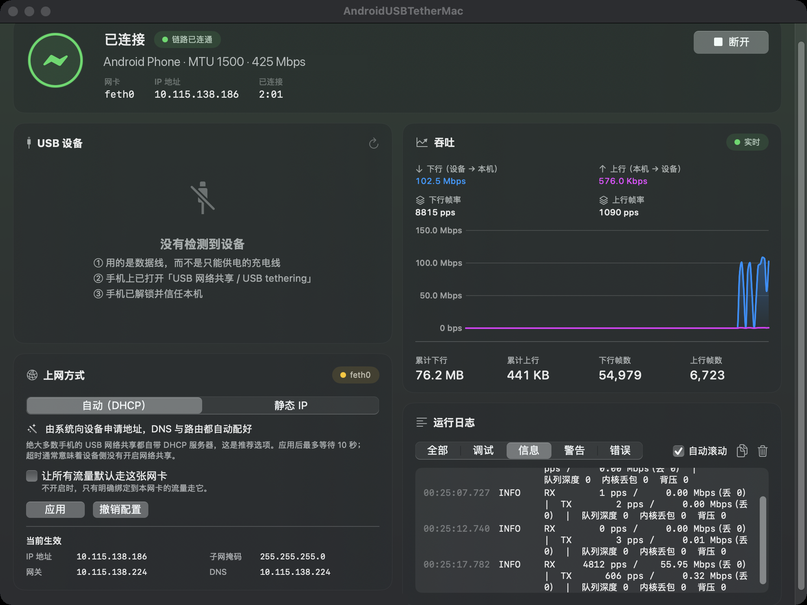
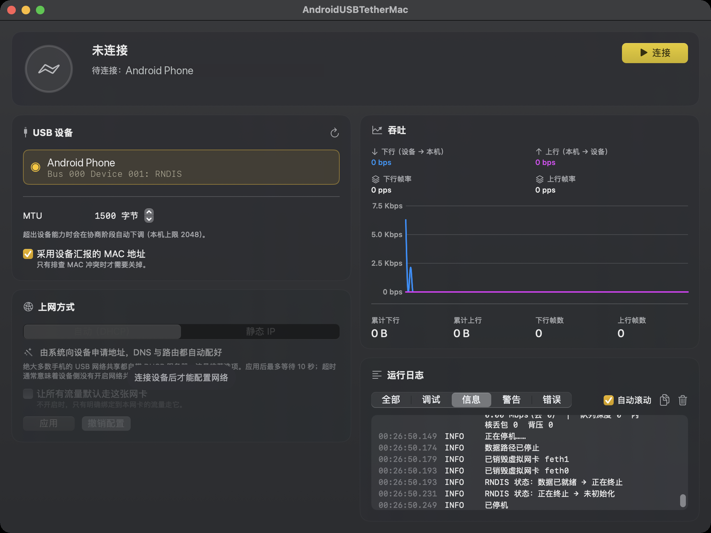

# AndroidUSBTetherMac

**安卓手机 USB 网络共享给 Mac —— 插线即用，不装内核扩展，不关 SIP。**

Android USB tethering (RNDIS) for macOS, without a kernel extension.

本仓库只发布安装包（Releases），不含源码。

| 已连接 | 未连接 |
|---|---|
|  |  |

## 系统要求

- Apple 芯片（M 系列）Mac，macOS 14 及以上（已在 macOS 27 实测）
- 支持「USB 网络共享」的安卓手机（RNDIS，绝大多数安卓机都是）

## 安装（DMG）

1. 到 [Releases](https://github.com/yzxq1/AndroidUSBTetherMac-releases/releases/latest) 下载 `AndroidUSBTetherMac-v*-macos-arm64.dmg`。
2. 双击打开 DMG，把 **AndroidUSBTetherMac** 拖到 **Applications（应用程序）**。
3. App 没有 Apple 开发者签名，首次打开会被 macOS 拦截。打开「终端」，粘贴下面一行回车：

   ```bash
   xattr -dr com.apple.quarantine /Applications/AndroidUSBTetherMac.app
   ```

   或者：先双击打开一次被拦截后，到「系统设置 → 隐私与安全性」底部点「仍要打开」。
4. 打开 App，点「安装特权组件」，输一次开机密码（创建虚拟网卡需要 root，只需装一次）。

## 使用

1. 手机用**数据线**连 Mac（不是只能充电的线）。
2. 手机打开「设置 → 连接与共享 → **USB 网络共享**」。
3. 在 App 里选中设备，点「**连接**」，上网方式选「自动（DHCP）」后点「应用」。
4. 想让所有流量都走手机，勾选「让所有流量默认走这张网卡」。

## 卸载

在 App 底部点「卸载特权组件…」，再把 App 拖进废纸篓。

## 校验

每个 Release 附带 `SHA256SUMS`：

```bash
shasum -a 256 -c SHA256SUMS
```

## 致谢与许可

- 基于 [XiaoMiku01/TetherKit](https://github.com/XiaoMiku01/TetherKit)（MIT）修改，感谢原作者和贡献者。本版本修复了空闲时 CPU 占满一个核的问题，以及 macOS 27 上特权组件安装失败的问题。
- 许可证：MIT，见 [LICENSE](LICENSE)。
- 内置 libusb（LGPL-2.1+），见 [THIRD_PARTY_NOTICES.md](THIRD_PARTY_NOTICES.md)。
